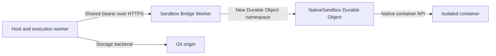

# Cloudflare integration

Catamorphic hosts can use Cloudflare for sandbox execution and Git origins.
These are independent injected backends. The Work desktop is the reference host;
libraries do not select a provider by reading environment variables.

Related: [INTEGRATION.md](INTEGRATION.md),
[bridge package](packages/cloudflare-sandbox-bridge/README.md),
[ADR 0310](docs/decisions/0310-cloudflare-sandboxes-use-native-containers.md).

## Execution architecture

`CloudflareSandboxProvider` in `@catamorphic/cloudflare` is an HTTP client. A
Worker in `packages/cloudflare-sandbox-bridge` authenticates those requests and
addresses a `NativeSandbox` Durable Object by the host's opaque sandbox id. That object
starts and operates its native `ctx.container`. `@cloudflare/sandbox` 1.x supplies
file operations through the matching `sandbox-shim` in the container image.



The native container API requires Workers bindings, so it cannot run inside a
Node or Bun host directly. The bridge is our own small HTTP adapter. The upstream
1.x package has no bridge, Sandbox class or warm pool.

The host's Environment and Allocation services decide placement, admission and
cleanup. The provider creates an id lazily and starts its container on the first
command or file operation. The selected image runs as a `lite` instance with
Internet access. Ten minutes of inactivity stops it; destroying a sandbox stops
it immediately. Native inactivity settings are restored after a Durable Object
restart. Each exec has its own working directory and environment.

The Wrangler configuration uses `scheduling_policy: "durable_object"` and an
`images.sandbox.dockerfile` entry. Instance size belongs to native `start()`, not
Wrangler's legacy `instance_type`. Native scheduling has no `max_instances`
field. The framework's existing Allocation admission remains authoritative.
Cloudflare cannot change the policy of an existing application or attach a
replacement to the existing Durable Object namespace. The replacement has its
own Worker name, `NativeSandbox` class, SQLite namespace and Container application.
Rehearse the replacement on a staging Worker.

A deployed workflow still runs an immutable artifact. Core uploads its verified
`.work/` capability snapshot, excluding mutable `app-data/`. The command deployment
runtime starts a Bun supervisor and sends workflow boundary and batch operations
to it. Postgres remains authoritative for queued work, retries, pauses,
continuations and terminal state. Coding-agent sandboxes can receive a complete
editable checkout through the same provider contract.

## Source layout

| Source | Responsibility |
| --- | --- |
| `packages/cloudflare-sandbox-bridge/src/index.ts` | Worker entry and NativeSandbox Durable Object |
| `packages/cloudflare-sandbox-bridge/src/bridge.ts` | Bearer authentication and sandbox routing |
| `packages/cloudflare-sandbox-bridge/src/sandbox.ts` | Native lifecycle, exec, files and workspace hydration |
| `packages/cloudflare-sandbox-bridge/src/process.ts` | Command process groups and native lifetime cleanup |
| `packages/cloudflare-sandbox-bridge/wrangler.jsonc` | Bindings and native container images |
| `packages/cloudflare-sandbox-bridge/Dockerfile` | Pinned Bun, Node and sandbox-shim image |
| `packages/cloudflare/src/sandbox-provider.ts` | Host-side provider and SSE client |
| `packages/cloudflare/src/artifacts-client.ts` | Artifacts REST client and short-lived Git tokens |
| `packages/cloudflare/src/artifacts-remote-backend.ts` | Git origin backed by Artifacts |

The bridge's [HTTP contract](packages/cloudflare-sandbox-bridge/README.md#http-api)
includes create, destroy, liveness, exec, raw file IO and tar hydration. File
uploads create their parents and replace the destination only after a complete
upload. Exec environment values travel as native API data and never become shell
source. GNU `timeout` owns each command's process group. A deadline or client
disconnect kills the group, including ordinary shell descendants. Deliberately
starting a new process session escapes that group. GNU timeout owns the deadline
without a Worker timer. Request listeners are removed when the native process
exits, so a later abort cannot signal it. `enable_request_signal` enables incoming
disconnect events; the Worker explicitly forwards `signal: request.signal`
through the Durable Object's `fetch()` boundary.

## Host configuration

These names are conventions for host boot code, not library configuration
switches:

| Host value | Purpose |
| --- | --- |
| `CLOUDFLARE_SANDBOX_API_URL` | Bridge URL, including its protocol |
| `CLOUDFLARE_SANDBOX_API_KEY` | Shared bearer, matching the Worker's `SANDBOX_API_KEY` |
| `CLOUDFLARE_ACCOUNT_ID` | Account used by the Artifacts client |
| `CLOUDFLARE_API_TOKEN` | Runtime token for Artifacts operations |
| `CLOUDFLARE_ARTIFACTS_NAMESPACE` | Artifacts repository namespace |

```ts
import { CloudflareSandboxProvider } from "@catamorphic/cloudflare";

const sandboxProvider = new CloudflareSandboxProvider({
  apiUrl: process.env.CLOUDFLARE_SANDBOX_API_URL!,
  apiKey: process.env.CLOUDFLARE_SANDBOX_API_KEY,
});
```

Construct the host's other backends independently and pass the provider to
`createCatamorphic`. S3-compatible storage, including R2, is available through
`@catamorphic/s3`; filesystem origins are also supported. Artifacts is optional.

## Local development

Use a dedicated worktree with `bun install` completed and Docker running.

```sh
cp packages/cloudflare-sandbox-bridge/.dev.vars.example packages/cloudflare-sandbox-bridge/.dev.vars
bun run --cwd packages/cloudflare-sandbox-bridge dev
```

The example supplies `SANDBOX_API_KEY=local-dev`. The Worker builds and runs its
container locally at `http://localhost:8787`. `bun run dev:infra` also starts the
optional bridge; it does not change the host's selected provider.

```sh
curl http://localhost:8787/health
```

Health returns `{ "ok": true }` without authentication or a container start.
All sandbox routes check the shared bearer. A missing key works only on a
loopback request URL; a deployed Worker without its secret rejects sandbox
requests with 503.

Set the host's URL to `http://localhost:8787` and its key to `local-dev`, then
construct the provider in the host. Artifacts has no local emulator. Leave its
configuration unset for a local-only environment, and choose a filesystem or
object-store origin in host boot code.

## Deploying the Worker

Cloudflare's native Durable Object container scheduling policy is in public
beta. Deployment needs a Workers Paid account with Containers enabled and Docker
to build the image. Use a Cloudflare deployment token scoped to the account with
**Workers Scripts: Edit**; optionally add **Workers Tail: Read** for remote logs.
Keep deployment credentials out of the host's runtime.

Use separate keys for each environment. The default Wrangler configuration is
production (`catamorphic-sandbox-bridge-native`); `--env dev` selects the separate
`catamorphic-sandbox-bridge-dev-native` Worker.

```sh
cd packages/cloudflare-sandbox-bridge
bunx wrangler secret put SANDBOX_API_KEY --env dev
bunx wrangler deploy --env dev
```

For production, use `--env ""` to select the default configuration explicitly.
Configure the deployed URL and the matching
shared key in the host. Cloudflare deploys its Worker and container image;
saving source, installing dependencies and running repository checks do not
perform that deployment.

A provider URL cutover is a maintenance operation. Keep the previous Worker
available, stop admitting new work to it, and drain its active allocations.
Preserve any files that cannot be rebuilt before releasing those allocations
through the old provider. Restart the host against the replacement URL/key and
admit fresh allocations. No container filesystem or Durable Object storage moves
to the new namespace, and the old scheduling policy cannot provide a container
snapshot for the transfer. Verify the replacement and that the old Worker has no
remaining work or unique data before separately retiring the old deployment.

To rotate the shared key, change the Worker secret, update the host's matching
key and restart the host's clients. API tokens for provisioning and Artifacts
can be rotated separately.

Keep the exact `@cloudflare/sandbox` package version and the Dockerfile's
`sandbox-shim` image tag together. Node and Bun are independently pinned in the
image. Build images afresh after base-image security updates so containers do
not retain an older certificate bundle or runtime.

## Artifacts storage

`ArtifactsClient` provisions repositories and mints short-lived Git tokens.
`ArtifactsRemoteBackend` exposes the generic `RemoteBackend` contract and uses
`isomorphic-git` for network Git operations. Hosts can choose it without changing
the sandbox provider.

Artifacts access depends on the account's current product entitlement. Provision
an account-scoped runtime token with **Artifacts: Edit** and create the namespace
through the current Cloudflare tooling. An account without access receives a
feature-gate error; use another injected Git origin while arranging access.

Artifacts origins do not retain member drafts (ADR 0191): their sandbox clone
tokens read every ref of the repository. A host that allows members to draft on
the server uses an object-store or bare-repository origin instead.

```ts
import { ArtifactsClient, ArtifactsRemoteBackend } from "@catamorphic/cloudflare";

const remoteBackend = new ArtifactsRemoteBackend({
  client: new ArtifactsClient({
    accountId: process.env.CLOUDFLARE_ACCOUNT_ID!,
    apiToken: process.env.CLOUDFLARE_API_TOKEN!,
    namespace: process.env.CLOUDFLARE_ARTIFACTS_NAMESPACE!,
  }),
  cachePath: "/var/catamorphic/artifacts-cache",
});
```

## Verification and troubleshooting

The normal repository checks exercise the host provider against the bridge's
native-container boundary without Cloudflare credentials. Manually run the
Worker with Docker to exercise workerd and the image together. Real Cloudflare
integration tests are a separate, explicitly authorized operation through
`bun run test:external`, with `CF_SANDBOX_INTEGRATION=1` and the intended bridge
URL/key. No test should infer authorization from credentials already present.

- **503 with `not_configured`**: configure the deployed Worker's shared secret.
- **401 from the bridge**: its secret and the host's bearer differ.
- **Container fails to start locally**: check Docker and the built image.
- **Native exec fails**: check its argv, absolute working directory, timeout and
  per-call environment. Image `WORKDIR` and start-time variables do not supply
  exec's directory or environment, apart from the native `PATH` behavior.
- **A file write fails in a new directory**: the bridge creates parents before
  using `Files.writeFile`; direct `Files` consumers must do that themselves.
- **Artifacts returns a feature-gate error**: check account access and runtime
  token scope independently of the sandbox bridge.

## References

- [Cloudflare Sandboxes](https://developers.cloudflare.com/sandbox/)
- [Native scheduling migration](https://developers.cloudflare.com/containers/guides/migrate-to-durable-object-scheduling-policy/)
- [Native process lifetime](https://developers.cloudflare.com/containers/api/durable-object-container/#process-lifetime)
- [Command process groups](https://developers.cloudflare.com/containers/guides/execute-commands/#stop-the-processes-a-command-starts)
- [Native command semantics](https://developers.cloudflare.com/sandbox/sdk/migrate/commands/)
- [Native file semantics](https://developers.cloudflare.com/sandbox/sdk/migrate/files/)
- [Bridge and warm-pool replacement](https://developers.cloudflare.com/sandbox/sdk/migrate/other-features/)
- [Containers](https://developers.cloudflare.com/containers/)
- [Artifacts](https://developers.cloudflare.com/artifacts/)
